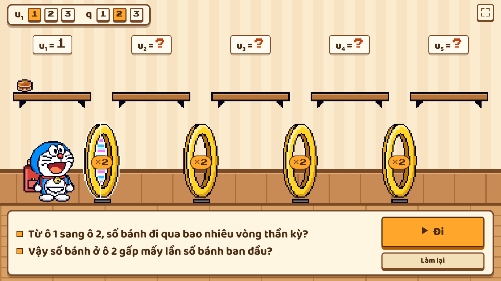
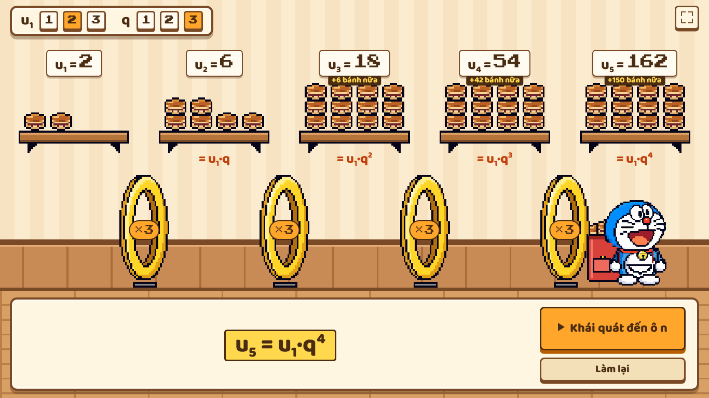

# Vòng nhân bản bánh rán: tổng quan

## Mục đích

Một trò chơi pixel trên một màn chiếu, dùng để khởi động bài **cấp số nhân**: học sinh tự tìm ra uₙ = u₁·qⁿ⁻¹. Giáo viên (hoặc một học sinh ở bảng) bấm từng bước, cả lớp dự đoán rồi trả lời. Ý tưởng gốc của giáo viên nằm ở `~/Prompt_Web_Doraemon_Canh_Cua_Nhan_Ban_Cap_So_Nhan.md`. Bản đó chỉ để tham khảo; game giữ câu chuyện, các câu hỏi và các trường hợp phải kiểm tra.

## Trên màn hình

- Một tiệm bánh có **5 ô** (kệ gỗ treo tường). Trên mỗi kệ ghi uₖ = số bánh của ô đó.
- Giữa hai ô là một **vòng thần kỳ** ghi ×q, tổng cộng 4 vòng.
- Doraemon đeo balo đỏ đựng bánh, đi từ ô 1 sang phải. Qua mỗi vòng, số bánh nhân q lần và bánh bay lên kệ của ô mới.
- Hộp thoại phía dưới chỉ có câu hỏi và câu trả lời, hoặc một công thức lớn.

## Luồng

Mỗi lần bấm nút cam (hoặc phím →) là một bước. Không có gì tự chạy, và không có đáp án nào hiện trước khi bấm.

1. Chọn u₁ và q (mỗi số 1, 2 hoặc 3) ở góc trái trên, rồi bấm **Bắt đầu**.
2. Với mỗi ô từ 2 đến 5:
   - hai câu hỏi gợi mở của giáo viên (vòng sắp đi qua nhấp nháy);
   - **Đi**: Doraemon qua vòng, số bánh và câu trả lời mong đợi hiện ra;
   - **Hiện công thức**: ví dụ u₃ = u₁·q². Dưới kệ ghi "= u₁·q²" và dòng này ở lại đến cuối.
3. Sau ô 4 có thể **Khái quát đến ô thứ n** (ô 5 là tùy chọn): **Hiện gợi ý** (các vòng đánh số 1–4, đáp án n − 1 vòng) rồi **Kết luận** uₙ = u₁·qⁿ⁻¹.
4. **Kết luận** là màn cuối (không còn màn chốt sau nút Kết thúc). Câu hỏi gọi "ô thứ k"; đáp án số lần gấp ghi q¹ lần, q² lần…

| Trường hợp kiểm tra | Kết quả |
|---|---|
| u₁=1, q=2 / u₁=1, q=3 / u₁=2, q=3 | 1, 2, 4, 8, 16 / 1, 3, 9, 27, 81 / 2, 6, 18, 54, 162 |
| u₁=3, q=1 | 3, 3, 3, 3, 3 (các vòng ghi ×1) |
| Ô 1 | 0 vòng, u₁ = u₁·q⁰ |
| Đổi u₁ hoặc q giữa chừng | Làm lại từ ô 1, không giữ lại gì |
| Trên 12 bánh | Vẽ 12 bánh và nhãn "+X bánh nữa"; số tổng ghi trên kệ |

Phím tắt:
- **R**: làm lại.
- **F**, hoặc biểu tượng ở góc phải trên: toàn màn hình.
- Chạm vào vòng đang nhấp nháy cũng là "Đi".
- Trong lúc Doraemon đang đi, mọi nút tạm khóa.

## Quyết định đã chốt (07/11/2026)

- **Một màn hình duy nhất**, pixel, đi tuyến tính kiểu game Mario, Doraemon nhún nhảy khi đi.
- **Bối cảnh tiệm bánh** màu kem và gỗ. Nền phố Tokyo bị bỏ vì "rối quá".
- **Phòng và cửa thành ô và vòng.** Chỗ để bánh gọi là "ô". Gọi là "vòng" sẽ nhầm với chính các chiếc vòng.
- **Ít chữ.** Đã bỏ tiêu đề, bộ đếm, âm thanh, bong bóng thoại, biển tên và bảng tổng kết che màn hình. Một công thức đơn lẻ nằm chính giữa phần trắng bên trái cột nút. Chữ trong hộp thoại tự thu nhỏ khi câu dài, để không dòng nào bị cắt.
- **Phông chữ:** Baloo 2 cho chữ (đủ dấu tiếng Việt), Press Start 2P chỉ cho con số.
- **Hình Doraemon có bản quyền**, do người dùng cung cấp ở `~/doraemon_pixel_art/`. Game không tự vẽ Doraemon và không lấy hình trên mạng.
- **Tỉ lệ thống nhất:** mọi thứ cùng một cỡ điểm ảnh. Doraemon (thu còn 90%) thấp hơn vòng, bánh nhỏ cùng cỡ với kệ. Viền các phần tự vẽ dùng màu viền của bộ hình.
- **Balo đỏ** thay cho bao bánh kéo lê; balo phồng lên khi bánh nhân lên.
- **Tên nút:** Bắt đầu, Đi, Hiện công thức, Khái quát đến ô thứ n, Hiện gợi ý, Kết luận, Làm lại.

